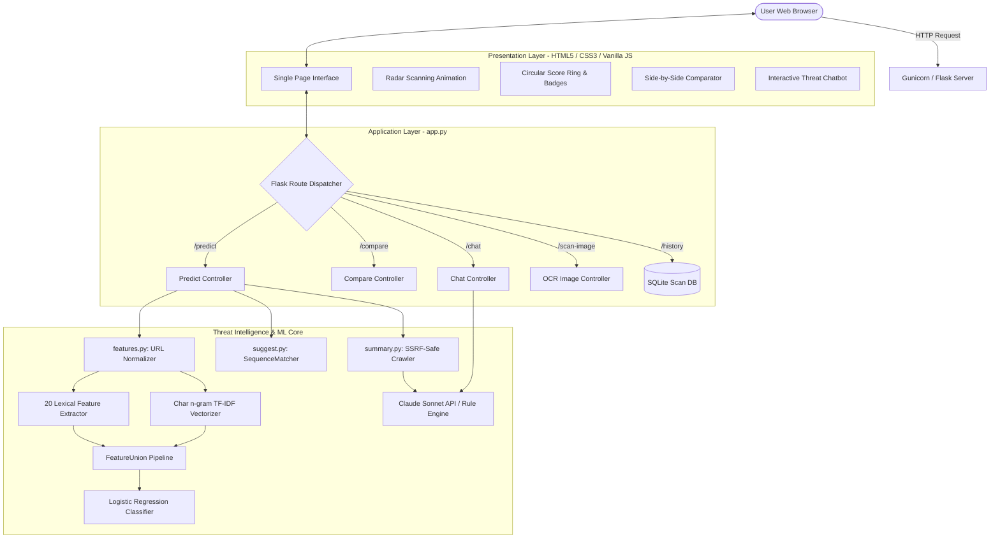

# JevShield: Intelligent Phishing URL Detection & DevOps Pipeline

[](https://www.python.org/)
[](https://flask.palletsprojects.com/)
[](https://scikit-learn.org/)
[](https://www.docker.com/)
[](https://www.jenkins.io/)
[](LICENSE)

**JevShield** is a responsive, web-only phishing detection and threat explanation system. Designed for both academic viva defense and real-world deployment, JevShield evaluates URLs using a machine learning model exceeding 94% test accuracy, extracts 20 hand-crafted lexical indicators, detects typo-squatted brand lookalikes, provides SSRF-safe website summaries, and hosts an interactive chatbot explaining threat signals. A complete DevOps pipeline (Git, pytest, Docker, Jenkins) retrains, tests, gates quality, and packages the application on every commit.

---

## Architecture Diagram



---

## Tech Stack & Architectural Decisions

| Technology | Purpose | Reason for Choice |
| :--- | :--- | :--- |
| **Python 3.11 / 3.13** | Backend & ML Runtime | Industry standard for data science, fast iteration, and robust library ecosystem. |
| **Flask 3.0** | Web Framework | Lightweight, clean, unbloated microframework without unnecessary boilerplate. |
| **scikit-learn** | Machine Learning Core | Standardized `Pipeline` and `FeatureUnion` architecture ensuring identical train & serve transforms. |
| **SQLite (sqlite3)** | Persistence | Zero-config, ACID-compliant file-based database ideal for scan history without dedicated database daemon. |
| **Gunicorn** | Production WSGI Server | High-performance multi-worker UNIX HTTP server handling concurrency for Flask. |
| **Pytest** | Test Automation | Declarative, scalable testing with zero external network dependencies in CI. |
| **Docker** | Containerization | Reproducible Linux container environment (`python:3.11-slim`), non-root execution, and isolated dependencies. |
| **Jenkins** | CI/CD Automation | Industry-standard declarative pipeline enforcing quality gates, automated training, and smoke tests. |
| **Vanilla HTML/CSS/JS** | User Interface | Zero frontend build step, instant browser loading, accessible, and easily maintainable. |

---

## Dataset Instructions

### Source Dataset
The full dataset is based on the Kaggle **"Phishing Site URLs"** benchmark (~549,346 rows) with two primary columns:
- `URL`: Raw web URL string
- `Label`: Ground-truth classification (`good` = safe, `bad` = phishing)

### Setup Steps
1. Download `phishing_site_urls.csv` from Kaggle.
2. Place the file at: `data/phishing_urls.csv` *(this large file is strictly excluded from Git commits via `.gitignore`)*.
3. Run the balancing and deduplication script:
   ```bash
   python -c "import pandas as pd; df = pd.read_csv('data/phishing_urls.csv').dropna().drop_duplicates(subset=['URL']); good = df[df['Label'] == 'good'].sample(10000, random_state=42); bad = df[df['Label'] == 'bad'].sample(10000, random_state=42); pd.concat([good, bad]).sample(frac=1.0, random_state=42).to_csv('data/sample_urls.csv', index=False)"
   ```
4. `data/sample_urls.csv` (20,000 balanced rows) is committed to Git and used by the automated CI pipeline.

---

## Model Evaluation & Cross-Validation Results

To select the winning model architecture honestly, three candidate classifiers were evaluated using **5-fold stratified cross-validation** strictly inside the training set.

### 5-Fold Cross-Validation Comparison Table (from `model/comparison.csv`)

| Candidate Architecture | Feature Representation | CV Phishing F1 | CV Accuracy | CV Precision | CV Recall | Training Time |
| :--- | :--- | :---: | :---: | :---: | :---: | :---: |
| **Candidate C (Winner)** | **TF-IDF Char n-grams (3-5) + 20 Hand-made Features + Logistic Regression** | **0.9319** | **0.9336** | **0.9569** | **0.9081** | 130.69s |
| **Candidate A** | 20 Hand-crafted Lexical Features + Random Forest (200 trees) | 0.8258 | 0.8293 | 0.8432 | 0.8091 | 10.54s |
| **Candidate B** | 20 Hand-crafted Lexical Features + HistGradientBoosting | 0.8204 | 0.8273 | 0.8548 | 0.7886 | 10.46s |

### Final Evaluation on Held-Out Test Set (4,000 URLs)
Candidate C was trained on the 16,000 training URLs and evaluated **once** on the held-out 4,000 test URLs:
- **Test Accuracy**: **94.05%** *(exceeds >90% gate)*
- **Phishing Precision**: **95.55%**
- **Phishing Recall**: **92.40%** *(exceeds >90% gate)*
- **Phishing F1 Score**: **93.95%**

**Confusion Matrix**:
```text
               Predicted Safe    Predicted Phishing
Actual Safe         1,914                 86
Actual Phishing       152              1,848
```

---

## Quick Start Guide

### Option 1: Run Locally (Python Virtual Environment)

```bash
# 1. Clone repository
git clone https://github.com/<your-username>/jevshield.git
cd jevshield

# 2. Create and activate virtual environment
python -m venv venv
# On Windows:
.\venv\Scripts\activate
# On Linux/macOS:
source venv/bin/activate

# 3. Install dependencies
pip install --upgrade pip
pip install -r requirements.txt

# 4. Optional: Set Anthropic API Key for AI Explanations
# On Windows:
$env:ANTHROPIC_API_KEY="your-api-key"
# On Linux/macOS:
export ANTHROPIC_API_KEY="your-api-key"

# 5. Start Flask development server
python app.py
```
*Open your browser and navigate to `http://127.0.0.1:5000`.*

---

### Option 2: Run via Docker

```bash
# 1. Build Docker image
docker build -t jevshield .

# 2. Run container with port forwarding and non-root user
docker run -d -p 5000:5000 --name jevshield-app -e ANTHROPIC_API_KEY="" jevshield

# 3. Test container healthcheck
curl http://localhost:5000/health

# 4. Run prediction curl test
curl -X POST http://localhost:5000/predict \
     -H "Content-Type: application/json" \
     -d '{"url":"http://paypal-security-login.com/auth"}'

# 5. Stop container
docker stop jevshield-app && docker rm jevshield-app
```

---

### Option 3: Jenkins CI/CD Pipeline Setup

1. **Prerequisites**:
   - Jenkins server with Git, Pipeline, and Docker plugins installed.
   - Jenkins agent with Docker daemon access.
2. **Credentials**:
   - Add `ANTHROPIC_API_KEY` under *Manage Jenkins → Credentials* as a **Secret text**.
   - Optional: Add `DOCKER_HUB_CREDENTIALS` as **Username with password** if pushing to Docker Hub.
3. **Pipeline Job Configuration**:
   - Create a **New Item** → Choose **Pipeline**.
   - Select **Pipeline script from SCM** → Choose **Git**.
   - Enter your repository URL and set Branch Specifier to `*/main`.
   - Set Script Path to `Jenkinsfile`.
4. **Trigger**:
   - Check **Poll SCM** with schedule `H/5 * * * *` (polls every 5 minutes) or configure a GitHub Webhook.
5. **Quality Gate Execution**:
   - If model accuracy or phishing recall falls below 90% (`MIN_ACCURACY=0.90`), the `Train & Accuracy Gate` stage automatically halts the build with exit code `1`.

---

## Honest Discussion of Real-World Limitations

While JevShield demonstrates strong accuracy (>94%) on test sets, in an academic viva defense it is crucial to recognize real-world evasion techniques:

1. **Zero-Day Phishing Domains**: Newly registered domains (NRDs) that mimic legitimate sites without obvious typos (e.g., using completely novel branding) may fool purely static lexical classifiers until reputation feeds or domain age checks update.
2. **URL Shorteners & Dynamic Redirects**: Attackers frequently hide malicious links behind shorteners (e.g., `bit.ly`, `tinyurl.com`) or multi-hop JavaScript redirection chains (`window.location = ...`) that evade non-executing HTTP crawlers.
3. **High-Entropy Benign CDNs**: Cloud providers and content delivery networks (e.g., `d8j0ntlcm91z4.cloudfront.net`, `s3.dualstack.us-east-1.amazonaws.com`) naturally have high character entropy and long tokens, which can trigger false-positive lexical flags if not cross-referenced against trusted infrastructure allowlists.
4. **Cloaking & Anti-Bot Detection**: Phishing toolkits often inspect client headers, IP geo-location, and user agents to serve benign pages to automated scanners and phishing payloads only to human victims.

---

## Screenshots Catalog for Viva Presentation

The following verified screenshots are located in [`screenshots/`](screenshots/):

| File | Resolution | Description |
| :--- | :---: | :--- |
| `screenshot_1280px.png` | 1280 × 950 | Desktop full viewport showing the hero section, dual input modes (Single/Compare), radar animation, and scan history table. |
| `screenshot_768px.png` | 768 × 1024 | Tablet responsive layout showing adapted card grids and responsive controls. |
| `screenshot_375px.png` | 375 × 812 | Mobile responsive view with full touch-friendly spacing and stacked scan cards. |
| `screenshot_safe.png` | 1280 × 950 | Detailed Safe URL scan result showing Green ring (Score: 98), safety badges, and safe page text summary. |
| `screenshot_phishing.png`| 1280 × 950 | Detailed Phishing scan result showing Red ring (Score: 0), short danger reasons, and SSRF-safe fallback message. |
| `screenshot_chatbot.png` | 1280 × 950 | Interactive AI chat panel providing real-time reasoning why a suspicious domain was classified as phishing. |
| `screenshot_compare.png` | 1280 × 950 | Side-by-side URL comparison feature showing simultaneous risk analysis with "Safer choice" badge. |

---

## Viva Defense Q&A Cheatsheet (Examiner Preparation)

**Q1: Why did you combine character n-grams with hand-crafted features instead of using Random Forest alone?**
> *Answer*: Hand-crafted features capture domain-level rules (like IP addresses, shorteners, dot counts, and security keywords), but cannot recognize novel character-level token patterns. Random Forest achieved 82.58% F1, whereas adding 3-to-5 character n-grams captured sub-word patterns (like `paypa1`, `secure-login`, `verif`) boosting cross-validation F1 to 93.19% and test accuracy to 94.05%.

**Q2: How does JevShield protect against Server-Side Request Forgery (SSRF) when summarizing pages?**
> *Answer*: In `summary.py`, the URL's hostname is resolved using `socket.getaddrinfo()`. The resolved IP is inspected before making any HTTP request. If the IP belongs to private (`10.0.0.0/8`, `172.16.0.0/12`, `192.168.0.0/16`), loopback (`127.0.0.1`), link-local (`169.254.0.0/16`), or multicast ranges, the request is aborted immediately with a security block note.

**Q3: How does the CI/CD pipeline prevent deploying an inaccurate model?**
> *Answer*: In `train.py`, after training on `data/sample_urls.csv`, the model evaluates against a held-out test split. If either accuracy or phishing recall falls below 90% (`MIN_ACCURACY`), the script terminates with exit code `1`. Jenkins detects this non-zero exit code in the `Train & Accuracy Gate` stage and immediately aborts the build before Docker packaging or deployment.
